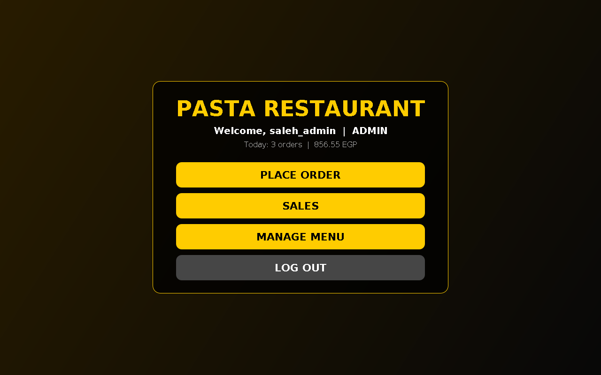
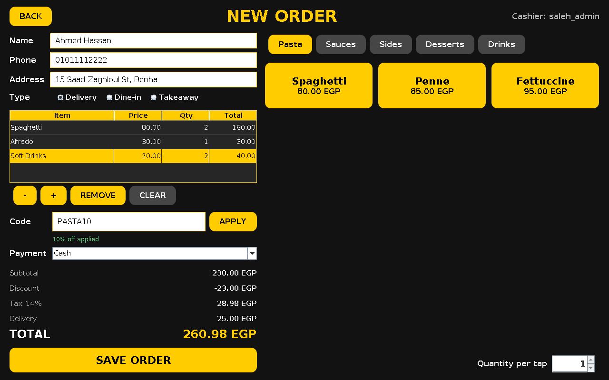
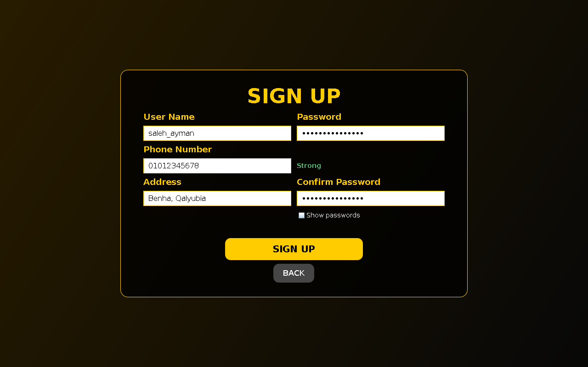

# Pasta Restaurant

A desktop restaurant management system built with **Java Swing**. It covers the full counter workflow: secure staff accounts, a configurable menu, order taking with pricing rules, printable receipts, and a sales dashboard with reports.

No external libraries and no database server are required. Everything runs on the JDK and stores data in plain CSV files.

## Screenshots

| Dashboard | New Order | Sign Up |
|---|---|---|
|  |  |  |

## Features

**Accounts and security**
- Sign up and log in with real authentication
- Passwords hashed with PBKDF2-WithHmacSHA256 (120,000 iterations) and a unique random salt per user
- Constant-time hash comparison and equalised timing for unknown usernames
- Login lockout for 30 seconds after 5 failed attempts
- Live password strength meter and show/hide password
- Role-based access: the first account becomes `ADMIN`, later accounts are `CASHIER`
- Admin-only screens (Sales, Manage Menu) enforced in the navigation layer
- CSV formula-injection protection on exports

**Ordering**
- Menu grouped by category (Pasta, Sauces, Sides, Desserts, Drinks), loaded from data
- Cart with quantity +/-, remove, clear, and quantity-per-tap
- Order types: Delivery, Dine-in, Takeaway
- Promo codes (`PASTA10` = 10%, `STUDENT15` = 15%)
- 14% VAT, delivery fee of 25 EGP waived for orders of 300 EGP or more
- Payment method: Cash, Card, Mobile Wallet
- Input validation for names, Egyptian mobile numbers, and delivery addresses

**Receipts**
- Formatted receipt with a sequential ID (`R000001`)
- Print directly or save as a `.txt` file

**Sales and reporting (admin)**
- Filter by day, month, year, and free-text search (ID, customer, phone)
- Sortable receipts table with an itemised details view
- KPIs: order count, revenue, average order, best seller
- Top items bar chart
- Export filtered results to CSV

**Menu management (admin)**
- Add, edit, and delete dishes and categories without touching code

**Quality**
- Single-window navigation with `CardLayout`
- Layered structure: `model`, `service`, `util`, `ui`
- Money handled with `BigDecimal`
- Atomic file writes to avoid corrupted data
- Global handler for unexpected errors

## Project structure

```
src/main/java/pasta
├── Main.java
├── model      Order, OrderLine, Dish, User, Role, Totals
├── service    AuthService, OrderService, MenuService, PricingService,
│              ReceiptService, Storage, Session
├── util       Money, Validator, Csv
└── ui         AppFrame, WelcomePanel, LoginPanel, SignUpPanel,
               DashboardPanel, OrderPanel, SalesPanel, MenuManagerDialog,
               ReceiptDialog, BarChart, Theme, RoundedButton, BackGround, Card
```

## Requirements

- JDK 17 or newer

## Run

With the helper scripts:

```
./run.sh        # Linux / macOS
run.bat         # Windows
```

With Maven:

```
mvn package
java -jar target/pasta-restaurant-2.0.0.jar
```

Open the folder in NetBeans, IntelliJ IDEA, or VS Code as a Maven project and run `pasta.Main`.

## Background image

Place your image at `src/main/resources/image/background.jpeg`. If it is missing, the app uses a dark gradient instead.

## Data

Data is stored in the `data/` folder next to where you launch the app (change it with `-Dpasta.data=/path`):

| File | Content |
|---|---|
| `users.csv` | accounts (salted hashes only, never plain passwords) |
| `menu.csv` | menu items |
| `orders.csv` | order headers |
| `order_items.csv` | order lines |

The folder is created on first run and is ignored by Git.

## First use

1. Start the app and choose **SIGN UP**. The first account is the admin.
2. Use **MANAGE MENU** to adjust dishes and prices.
3. Use **PLACE ORDER** to take orders and **SALES** to review them.

## Roadmap

- Unit tests for pricing, validation, and storage
- Order cancellation and refunds
- User management screen for admins
- SQLite storage
- Arabic / English language switch

## Tech

Java 17, Swing, Maven.
